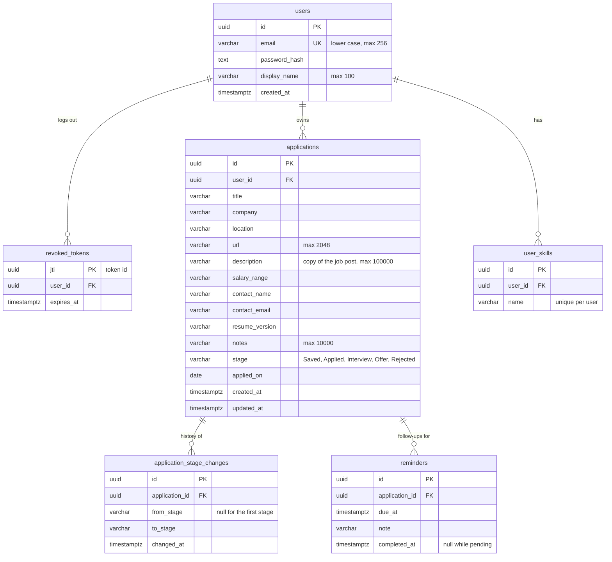

# Database design

JobTrail stores its data in PostgreSQL. The API talks to it through Entity Framework Core, and the schema is created by EF Core migrations in `api/JobTrail.Api/Data/Migrations/`.

Each table gets its migration in the sprint that adds its API, so the database only holds what the code uses. The tables of later sprints are the plan and may change a little when they are built.

## Diagram

## Tables

| Table                       | Purpose                                                                                                                                                    | Sprint | Status                      |
| --------------------------- | ---------------------------------------------------------------------------------------------------------------------------------------------------------- | ------ | --------------------------- |
| `users`                     | Accounts. The email is stored in lower case and is unique. Passwords are stored only as a salted hash.                                                     | 1      | Migration `InitialAuth`     |
| `revoked_tokens`            | JWTs that were logged out before they expired. Every authenticated request checks this table. Expired rows are deleted on logout.                          | 1      | Migration `InitialAuth`     |
| `applications`              | One job application. The job description is copied here so it is kept even if the post is taken down. `stage` is the current column on the board.          | 2      | Migration `AddApplications` |
| `application_stage_changes` | One row each time an application changes stage (including the first one), used by the history view and the statistics (response rate, time in each stage). | 2      | Migration `AddApplications` |
| `reminders`                 | Follow-up dates for an application. Due reminders show on the extension badge and as browser notifications.                                                | 4      | Planned (enhancement)       |
| `user_skills`               | The user's skills, compared with the words in job descriptions for Skills Matching.                                                                        | 3      | Planned (API), 4 (screens)  |

## Rules

- **Every row belongs to a user.** `applications` and `user_skills` have a `user_id`; `application_stage_changes` and `reminders` belong to a user through their application. The API always filters by the signed-in user's id (the `sub` claim of the JWT), so nobody can read or change another user's data.
- **Deleting cascades.** Deleting a user deletes their rows in every table. Deleting an application deletes its stage changes and reminders.
- **Names.** Tables and columns use `snake_case` (set with `UseSnakeCaseNamingConvention()` in `Program.cs`). Primary keys are UUIDs; user ids are UUID v7, which sort by creation time.
- **Dates.** Moments in time are `timestamptz` and are always written in UTC. Calendar dates with no time (like `applied_on`) are `date`.

## Changing the schema

1. Change the model classes in `api/JobTrail.Api/Models/` and `AppDbContext`.
2. From `api/`: `dotnet ef migrations add <Name> --project JobTrail.Api --output-dir Data/Migrations`
3. Run the API: in Development it applies new migrations on startup. (Or run `dotnet ef database update --project JobTrail.Api`.)
4. Commit the new migration files together with the model change. Never edit a migration that is already merged into `development`: add a new one instead.
